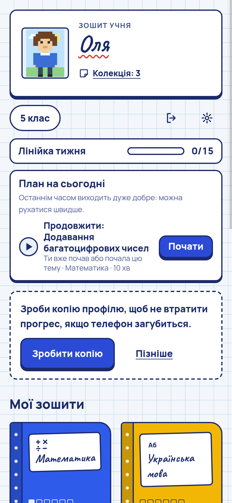
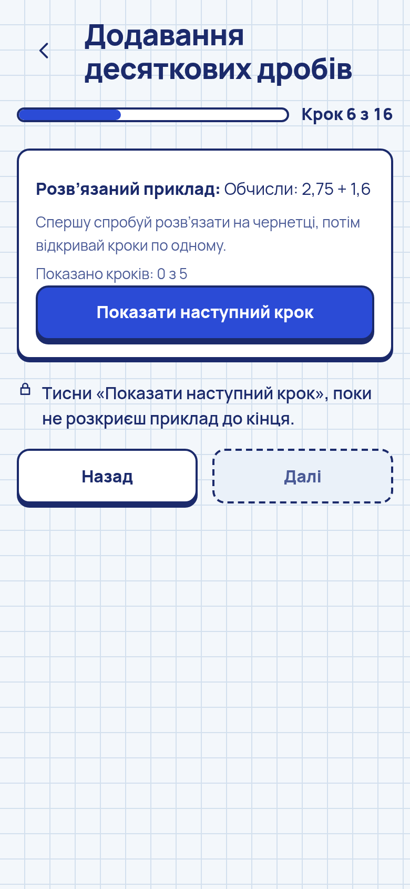
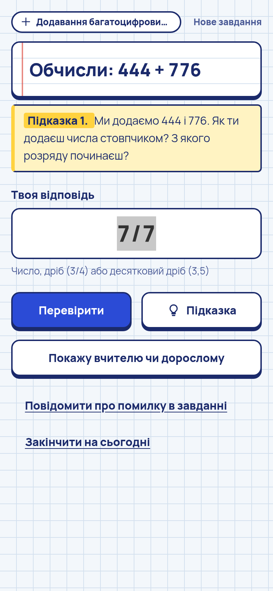
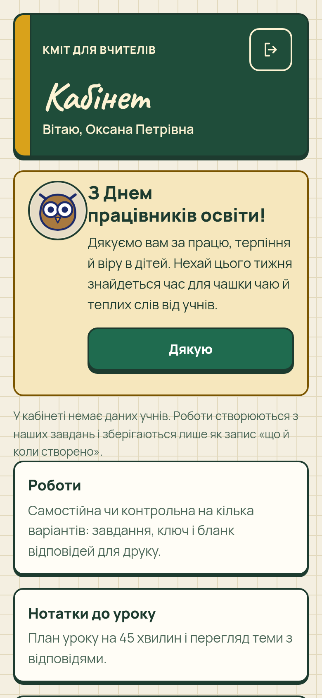

# Kmit

[](https://github.com/sashapiscivca-svg/kmit/actions/workflows/ci.yml) [](LICENSE) [](LICENSE-CONTENT.md)

**English** · [Українська](README.uk.md)

Kmit is an offline learning companion for Ukrainian schoolchildren in grades 5–12, built around the New Ukrainian School (НУШ) curriculum. It explains a topic, gives hints that never reveal the answer, and schedules spaced review. Everything a child does stays on the device, encrypted. The app has no network permission, no ads, no analytics and no accounts. The same app has a separate teacher profile with printable worksheets and a lesson library, and a separate reviewer build lets subject methodologists proofread the content.

The user interface and all learning content are in Ukrainian.

> [!WARNING]
> **Status: pre-alpha. Not ready for use with children.**
> - The Android app has been built and checked only by automated tests and in a desktop browser. **It has never been run on a real phone** (or an emulator).
> - **All learning content was drafted with AI agents** and checked by an automated "blind" answer-key pass. **It has not yet been reviewed by human methodologists and may contain factual or methodological errors.** Every content pack is marked `draft`; this label is currently shown only in the teacher's lesson library, not to children.
> - Content exists for **grades 5–7 only**. Mathematics exists for grade 5 only. Grades 8–12 are not started (the app shows them as "coming").

## Screenshots

<table>
  <tr>
    <td align="center"><br><sub>Home: today's plan, subject notebooks</sub></td>
    <td align="center"><br><sub>Lesson: worked example, step by step</sub></td>
    <td align="center"><br><sub>Task: a hint without the answer</sub></td>
    <td align="center"><br><sub>Teacher cabinet</sub></td>
  </tr>
</table>

Screenshots are taken from the browser build with test data (the profiles are fictional).

## Key features

- **Lessons, not just tests.** Every topic has a short lesson with text, worked examples revealed step by step, self-check questions and the child's own notes.
- **Hints that teach.** A ladder of graded hints, then an analogous worked example with *different* numbers, then "ask an adult". For computational (maths) tasks the answer and intermediate results are never shown to the child; this is enforced in code, not by convention (see [Invariants](ARCHITECTURE.md#invariants)). For factual subjects the correct answer is shown with an explanation after the child's own attempt.
- **Adaptive practice.** A deterministic engine tracks mastery (Bayesian Knowledge Tracing with fixed parameters), picks what is within reach, interleaves topics and schedules spaced review at growing intervals.
- **Maths generators.** Grade 5 maths tasks are generated by Rust code with an exact arithmetic oracle (35 skills), so the answer key is computed, not written by hand.
- **Motivation without pressure.** A finite sticker album and a "world" of creatures for each grade, a pixel hero, a weekly effort ruler. Rewards are only added, never taken away, and never depend on speed. The grade-transition celebration never blocks moving on or going back.
- **Teacher profile.** Printable worksheets (independent work, test, homework, NMT-style practice) in up to 4 variants with answer key, answer sheet and cut-out cards (PDF); dictations and gap-fills for language topics; a 45-minute lesson plan and student handout; a searchable lesson library with bookmarks; a printable topic plan. The teacher profile holds no student data.
- **Reviewer app.** A separate build ("Kmit Методист") for methodologists: mark each text as OK, fix it or remove a task, then export one CSV file that `content-tools apply` merges into the packs.
- **Content as data.** Lessons and task banks live in JSON packs (`kmit-pack-1`). Newer signed packs (Ed25519) can be installed from a file without reinstalling the app.
- **Accessibility.** Font scaling, reduced motion, light ("paper") and dark ("chalkboard") themes, Android text-to-speech (not yet verified on a device).

## Privacy principles

- **No network.** The Android manifest removes `INTERNET`. `compliance_tests` fail if `INTERNET`, `AD_ID`, location, camera, microphone, contacts or similar permissions appear, if ad or analytics libraries are added, or if the UI references external URLs.
- **Encrypted local storage.** Each profile is a SQLCipher database whose random 256-bit key is wrapped twice: with a key derived from the PIN (Argon2id) and with a one-time recovery code. Deleting a profile destroys the wrapped keys (crypto-erase). Android backup is disabled; screenshots are blocked by default.
- **Data minimisation.** A child profile stores a nickname and an avatar number, never a surname, school, photo or birth date. Up to 4 profiles per device.
- **Child data never reaches the teacher digitally.** The child can print or save a sheet and show it in person. Teacher and child profiles cannot read each other's data, and there is no import of children's work.
- **No ads, analytics, accounts, purchases or chat.**

Privacy policy (draft): [English](docs/legal/privacy-policy.en.md) · [Українська](docs/legal/privacy-policy.uk.md).

## Quick start for developers

Requirements: a stable Rust toolchain (MSRV 1.80; CI uses current stable), a C compiler, `perl` and `make` (SQLCipher and OpenSSL are compiled from source), Node.js ≥ 22 for UI checks, and Chromium or Chrome for end-to-end tests.

```bash
git clone https://github.com/sashapiscivca-svg/kmit.git
cd kmit

# Run the app in a desktop browser (the same Rust core as on Android)
scripts/dev.sh                     # then open http://127.0.0.1:8765/
                                   # data: ~/.local/share/kmit-dev (override with KMIT_DATA; port with PORT)

# Checks (the same as CI)
cargo fmt --all --check
cargo clippy --workspace --all-targets -- -D warnings
cargo test --workspace
scripts/check_ui.sh                # JS syntax + no language features unknown to old Android WebViews

# End-to-end UI tests in headless Chromium
CHROME=/path/to/chrome THEME=light scripts/e2e.sh
CHROME=/path/to/chrome THEME=dark  scripts/e2e.sh
CHROME=/path/to/chrome scripts/e2e-reviewer.sh
```

`scripts/dev.sh` runs `dev-server`, a small HTTP server built on the Rust standard library that listens on 127.0.0.1 only and passes UI commands to the core. It is a development tool, not part of the product. Note that the scripts call Cargo with `--offline`, so run `cargo fetch` once after cloning. More testing notes (in Ukrainian): [docs/how-to-test.md](docs/how-to-test.md).

### Android

The Android app is a Tauri 2 shell (`app/src-tauri`). Building it needs the Android SDK and NDK, JDK 17 and `tauri-cli`. See **[BUILDING.md](BUILDING.md)** for toolchain versions, environment setup, signing and how to verify that the APK has no `INTERNET` permission.

## Repository layout

| Path | What it is |
|---|---|
| `crates/tutor-core` | Pure engine, no I/O: tasks, hint ladder and leak guard (invariants I1–I3), BKT mastery model, spaced review, sessions and limits, exact fractions, deterministic RNG, lessons, sticker album, pixel hero, teacher-sheet model |
| `crates/course-pack` | Skill graph of a course: nodes, prerequisites, integrity checks (no duplicates, no unknown prerequisites, no cycles) |
| `crates/tutor-engine` | Chooses the next skill and task: readiness, interleaving, review, limits, de-duplication; builds the teacher sheet from learner state. Deterministic |
| `crates/generators-math` | Grade 5 maths: 35 skills with task generators, oracles, scripted hints, typical-error messages, lessons and figures |
| `crates/subjects` | All other subjects: loads the embedded JSON packs (`crates/subjects/packs/*.json`, format `kmit-pack-1`), validates them and verifies signatures of installable packs |
| `crates/storage` | Encrypted storage: SQLCipher database, Argon2id + XChaCha20-Poly1305 key wrapping, PIN lockout, recovery code, profiles, encrypted export |
| `crates/report` | Minimal PDF generator with embedded fonts (Cyrillic): child's sheet, teacher worksheets and keys, lesson plans, certificates |
| `crates/app-core` | Application core: one JSON command interface for all shells; child, teacher and (feature `reviewer`) reviewer commands; compliance tests |
| `crates/content-tools` | Content CLI: `validate`, `review` (CSV/HTML for methodologists), `apply`, `approve`, `keygen`, `sign`, `verify` |
| `crates/dev-server` | Desktop browser server for development and e2e tests (127.0.0.1 only) |
| `app/ui` | Child and teacher UI: plain ES modules, no dependencies, no build step |
| `app/reviewer` | Reviewer UI (assembled by `scripts/build-reviewer-ui.sh`) |
| `app/src-tauri` | Tauri 2 Android shell (separate Cargo workspace and lock file) |
| `app/e2e` | End-to-end scenarios for headless Chromium |
| `scripts/` | Dev server launcher, checks, APK builds, content lint and merge, icon and licence helpers |
| `site/` | Static landing page and presentation (self-contained HTML) |
| `docs/` | Specifications and guides (mostly in Ukrainian), see [docs/README.md](docs/README.md) |

How the pieces fit together: **[ARCHITECTURE.md](ARCHITECTURE.md)**.

## Content and how it is made

| Grade | Subjects with content | Topics (each with a lesson) |
|---|---|---|
| 5 | Maths (generated tasks), Ukrainian language, Ukrainian literature, English, History, Nature studies, Informatics | 134 |
| 6 | Ukrainian language, Ukrainian literature, English, History, Biology, Geography, Informatics | 136 |
| 7 | Ukrainian language, Ukrainian literature, English, History, Biology, Geography, Physics, Chemistry, Informatics | 176 |

In total: 446 topics, 10,886 multiple-choice items and 444 typed-answer items in 23 packs, plus generated grade 5 maths tasks. Not yet present: maths for grades 6–7, typed-answer items for grades 6–7, and anything for grades 8–12.

The pipeline, honestly described:

1. **Draft.** AI agents write a topic plan from the official curriculum, then a lesson and 26–30 tasks per topic, each task with three hints and an explanation. Textbook texts are not copied.
2. **Lint.** `scripts/pack_lint.py` and `cargo test -p subjects` check structure, lengths, readability, that hints do not name the answer, and gender-neutral wording.
3. **Blind key check.** A separate agent answers every multiple-choice item without seeing the key (`scripts/blind_quiz.py`); each disagreement is examined and the item is fixed where the key was wrong. For grade 5 maths the key is computed by the Rust oracle instead.
4. **Merge.** `scripts/pack_merge.py` builds the pack and the test suite runs.
5. **Human review — not done yet.** Methodologists proofread in the reviewer app; `content-tools apply` and `approve` move a pack from `draft` to `reviewed` or `approved`. **No pack has reached this stage.**

Steps 1–4 reduce errors but do not replace subject experts. If you find a mistake, please open a "Content error" issue. Format and workflow (in Ukrainian): [docs/content-packs.md](docs/content-packs.md), [docs/review-workflow.md](docs/review-workflow.md), [docs/reviewer-app.md](docs/reviewer-app.md).

## Documentation

| Document | Language | About |
|---|---|---|
| [BUILDING.md](BUILDING.md) | EN, with UK summary | Toolchains, Android build, signing, permission check |
| [ARCHITECTURE.md](ARCHITECTURE.md) | EN | Crates, builds, data flow, storage, invariants |
| [CHANGELOG.md](CHANGELOG.md) | EN | Release notes |
| [docs/README.md](docs/README.md) | UK | Index of specifications and guides |
| [CONTRIBUTING.md](CONTRIBUTING.md) | UK | How to contribute, DCO sign-off, licence grant |
| [SECURITY.md](SECURITY.md) | UK | Reporting security and privacy issues |
| [CODE_OF_CONDUCT.md](CODE_OF_CONDUCT.md) | EN, UK | Community standards |

## License

Kmit is **source-available, not open source** in the OSI sense: commercial use is not permitted without a separate licence.

- **Code:** [PolyForm Noncommercial License 1.0.0](LICENSE).
- **Content** (lessons, tasks, hints, explanations, content packs): [CC BY-NC-SA 4.0](LICENSE-CONTENT.md).
- **Fonts:** SIL Open Font License 1.1 ([LICENSES/](LICENSES/)).
- **Third-party components:** see [NOTICE](NOTICE) and the in-app screen "Ліцензії та подяки" (Licences and acknowledgements).
- **Name and logo:** "Kmit" and its logo are not licensed under any of the above; see [TRADEMARKS.md](TRADEMARKS.md).

Copyright © 2026 Oleksandr Shynkarenko (Олександр Шинкаренко). For commercial licensing, write to sasha.piscivca@gmail.com.

## Contributing

Contributions to code and content are welcome, especially reviews by teachers and subject methodologists. Please read [CONTRIBUTING.md](CONTRIBUTING.md) first: every commit needs a DCO sign-off (`git commit -s`), and contributions are made under the licence grant described there. Never add children's data, PINs, recovery codes or signing keys to the repository. This project follows the [Code of Conduct](CODE_OF_CONDUCT.md).

- Bugs: open an issue (without any child's data).
- Content errors: use the "Content error" issue template.
- Security or privacy problems: **do not open a public issue**; see [SECURITY.md](SECURITY.md).

## Contact

Oleksandr Shynkarenko, sasha.piscivca@gmail.com: questions, pilot participation, methodologist review, commercial licensing. Security and privacy reports: GitHub private vulnerability reporting or the same address, as described in [SECURITY.md](SECURITY.md).
